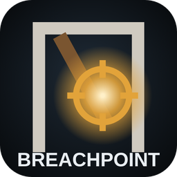

<p align="center"></p>

# BREACHPOINT: TASK FORCE

A top-down tactical squad shooter with a deep management layer, written in **C#** on **MonoGame**. Customize operators, build weapons in a detailed gunsmith, plan breaches with GO codes, clear multi-floor buildings, rescue hostages, arrest suspects, collect evidence, and dismantle four criminal organizations.

Runs on **Windows, Linux and Android** from one codebase. **No asset files:** all art is painted procedurally in code, and every sound and music bed is synthesized at startup.

[](../../actions/workflows/build.yml)

## Download

Grab the latest build from the **[Releases](../../releases)** page:

- **Android:** download `Breachpoint-2.0.x.apk` on your phone, open it and allow installs from this source (Android 6.0+).
- **Windows:** download `Breachpoint-win-x64.zip`, extract it and run `Breachpoint.exe`.
- **Linux:** download `Breachpoint-linux-x64.zip`, extract it and run `./Breachpoint`.

## Develop in VS Code

See **[docs/VSCODE_SETUP.md](docs/VSCODE_SETUP.md)** for the full PC setup guide. Short version:

1. Install the [.NET 8 SDK](https://dotnet.microsoft.com/download/dotnet/8.0), [VS Code](https://code.visualstudio.com) and [Git](https://git-scm.com).
2. Clone the repository and open the folder in VS Code; accept the recommended C# extensions.
3. Press **F5** to play, or use **Terminal → Run Task** for `test`, `autotest`, `publish`, `android` and so on.

```bash
dotnet run --project src/Breachpoint.Desktop
```

```bash
dotnet test
```

## Architecture

```
src/Breachpoint.Core      Game rules: data, saves, mission factory, results, procedural maps, simulation & AI (no graphics; unit-tested)
src/Breachpoint.Game      Shared MonoGame layer: software canvas + procedural art, GPU map renderer, synth audio, immediate-mode UI, screens
src/Breachpoint.Desktop   Desktop launcher (DesktopGL: Windows / Linux / macOS)
src/Breachpoint.Android   Android launcher (fullscreen landscape, native text-to-speech, vibration, on-screen keyboard)
tests/                    xUnit tests: every map type is generated and simulated by a bot
```

The simulation emits sound, effect and voice events that the presentation layer consumes, so the rules run identically in tests, on desktop and on phones.

## Features

- **Campaign:** 4 fictional organizations and 16 operations. Evidence builds intel on each organization, low intel makes takedowns harder, and captured bosses weaken the next organization.
- **Operations board:** 14 procedural mission types (warrant, hostage, drug lab, warehouse, compound, bank, airport cargo, hotel, bunker, shipyard, rural, prison riot, store, mansion), plus a weekly challenge, HVT contracts and a full **Sandbox** builder.
- **Difficulty:** Casual / Standard / Veteran / Milsim, plus **Ironman** (permadeath).
- **Operators:** 8 attributes, 7 personalities, 7 roles, levels, 11 abilities, morale, fatigue, injuries, bonds and a memorial wall. Full appearance customization: face, skin, hair, facial hair, build, 8 uniform presets plus custom colours, helmet, balaclava, eye protection, headset, gloves, boots, kneepads, watch, patch and unit ID.
- **Gunsmith:** 26 firearms and 35 attachments across 10 slots, each affecting weight, handling, recoil, accuracy, ergonomics, aim speed, reliability, suppression and visibility. Finishes, custom camo, engraving, serials, wear and maintenance, with a rotatable, zoomable inspection view.
- **Tactics:** real time with pause and a planning phase. Breach menu (open, kick, flashbang & clear, breaching charge, shotgun, ram, lockpick, door camera, stack up), GO codes, follow and formations, cover, crouch, pace, flashbangs, smoke, tear gas and diversions.
- **AI:** suspects need time to notice you. They hear gunfire, doors and footsteps, use radios, investigate, hold angles, rush, hide, surrender (and sometimes fake it), flee, and hostage guards execute hostages when alerted. Civilians panic, cower or flee.
- **Combat:** ballistics with armor and helmet penetration, hit locations, cover, glass, friendly-fire checks, suppression stress, malfunctions, reloads, and downed operators who bleed out unless treated.
- **Presentation:** pseudo-3D extruded walls, stencil-buffer fog of war from real vision cones, night ops with weapon lights, rain, muzzle flashes, tracers, casings, decals, smoke, explosions and flash-blindness.
- **After action:** S/A/B/C/Failed rating across 9 categories, pay and XP, and a **replay** viewer with per-operator **body cams**.
- **Touch controls:** tap to select and order, long-press for waypoints, drag to pan, pinch to zoom, twist to rotate, plus an on-screen order panel. The Android back button pauses.

### Mission controls (PC)

| Input | Action |
|---|---|
| LMB / drag | Select / box-select · **1–8** select operator |
| RMB | Move (Shift = add waypoint; RMB-drag = move + facing) |
| RMB door / suspect / civilian / item / teammate | Breach menu / arrest / secure / collect / treat |
| Space · Enter | Pause · Execute / GO |
| G T Y U | Flashbang / smoke / gas / diversion |
| H F R V C O Z N B X | Hold, follow, regroup, cover, crouch, face, pace, formation, wait-for-GO, cancel |
| WASD · wheel · Q/E · Tab | Pan · zoom · rotate · floor |

## Earlier version

The original HTML5/JavaScript version is preserved in git history and in the `apk-v1.0.2` release.
